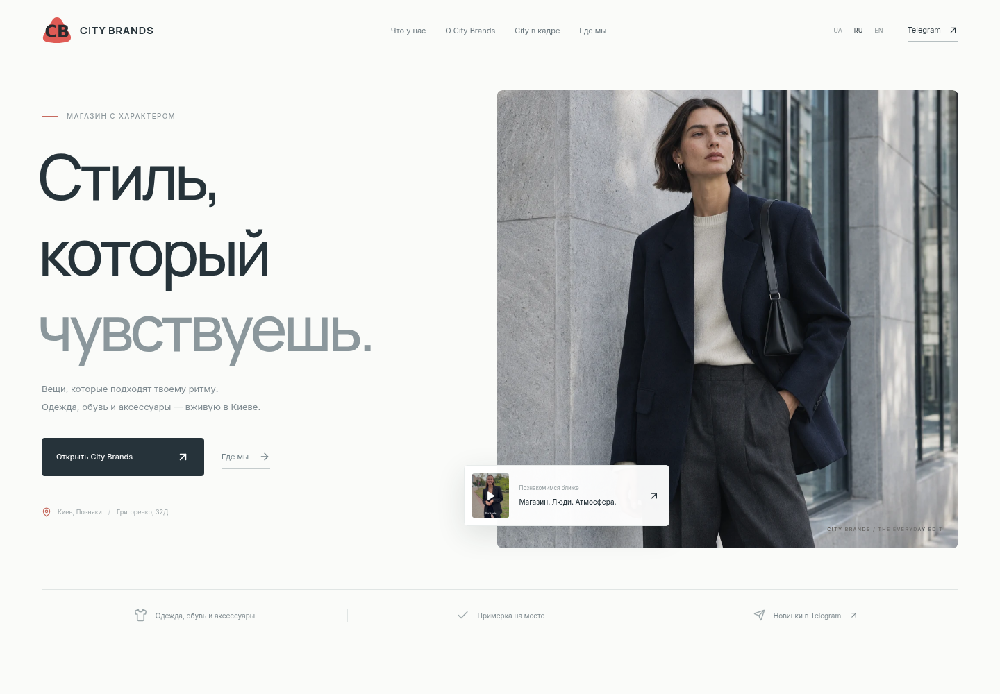

# City Brands

Адаптивный лендинг магазина City Brands на React 19, TypeScript и Vite. Три языка: украинский, русский и английский. Выбор сохраняется в браузере; ссылки `?lang=uk`, `?lang=ru`, `?lang=en` открывают нужную версию напрямую.



[Мобильное превью](docs/preview-mobile.png)

## Запуск

Требуются Node.js 22.12+ и npm.

```sh
npm ci
npm run dev
```

Рабочая директория: `/workspace/city_test`. Каждая облачная задача уже изолирована: используйте существующий checkout, не создавайте Git worktree без запроса пользователя.

```sh
npm run build       # проверка TypeScript и production-сборка в dist/
npm run preview     # просмотр production-сборки
npm run test:e2e    # браузерные проверки
```

Для тестов автоматически используется системный Chromium, если он установлен в `/usr/bin/chromium`. В другой среде установите браузер через `npx playwright install chromium` или укажите путь в `PLAYWRIGHT_CHROMIUM_EXECUTABLE_PATH`.

## Контент

- `src/App.tsx` — разделы страницы, фильтры, контакты и FAQ.
- `src/content.ts` — ролики, категории, Telegram и адрес магазина.
- `src/components.tsx` — логотип, компоненты появления при прокрутке и видеоплеер.
- `src/i18n.tsx` — переводы, выбор языка и метаданные страницы.
- `src/styles.css` — светлая адаптивная вёрстка, типографика и поддержка reduced motion.
- `src/effects.ts` — Lenis, GSAP ScrollTrigger, раскрытие изображений и смена кадров магазина при прокрутке.
- `public/brand-mark.svg` — векторный знак CB по предоставленному образцу, также используется как favicon.
- `public/media/` — четыре оптимизированных ролика пользователя, их постеры и fashion-визуал первого экрана. Ролики запускаются по нажатию и сохраняют исходный звук.

Сайт работает без серверной части, API-ключей и внешних запросов к шрифтам. Локальные шрифты — Manrope и Inter. Категории фильтруются и открывают соответствующее видео; наличие и размеры предлагается уточнять в Telegram. Часы работы не выдуманы: ссылка ведёт в канал магазина. На первом экране — новый иллюстративный fashion-визуал с одной моделью (`editorial-campaign.webp`), выбранный по пожеланию пользователя; он не представляет конкретные товары в наличии. Фотографии магазина, карточки и ролики взяты из материалов пользователя.

Это сайт-витрина: корзины, оплаты и оформления заказов нет. Пользователь знакомится с магазином, смотрит реальные видео, открывает Telegram или строит маршрут. Бегущая строка, звёздочки и непрерывно движущиеся надписи удалены. Анимации запускаются при входе в экран или следуют за прокруткой. На широких экранах кадры магазина плавно сменяются внутри закреплённой сцены; на телефонах появляются последовательно. При системной настройке reduced motion инерционная прокрутка и анимации отключаются, контент сразу видим.

Адрес: проспект Петра Григоренка, 32Д, Київ, 02140. Контактный блок показывает реальный вход из предоставленного видео; кнопка маршрута открывает Google Maps с точным адресным запросом.

Для публикации разместите содержимое `dist/` на статическом хостинге. Публикация и домен на этом этапе не настроены.
